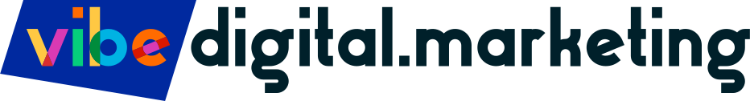

  <a href="https://www.vibedigital.marketing">
    <picture>
      <source media="(prefers-color-scheme: dark)" srcset="assets/vibe-lockup-white.svg">
      
    </picture>
  </a>

<h3 align="center">Your Key To Online Business Growth</h3>

Vibe Digital Marketing helps local businesses and community organizations grow online with **SEO**, **social media** and **web design**, built around the tools they already run on, especially **Square**, **Google Workspace** and **WordPress**.

We also build software for **destination marketing organizations**: the downtown districts, festivals and arts venues that bring visitors to their communities. It covers events, volunteers, boards and committees, and the tourism-impact reporting that comes with hotel occupancy tax funding.

**Work with us:** [www.vibedigital.marketing](https://www.vibedigital.marketing) · [info@vibedigital.marketing](mailto:info@vibedigital.marketing)
